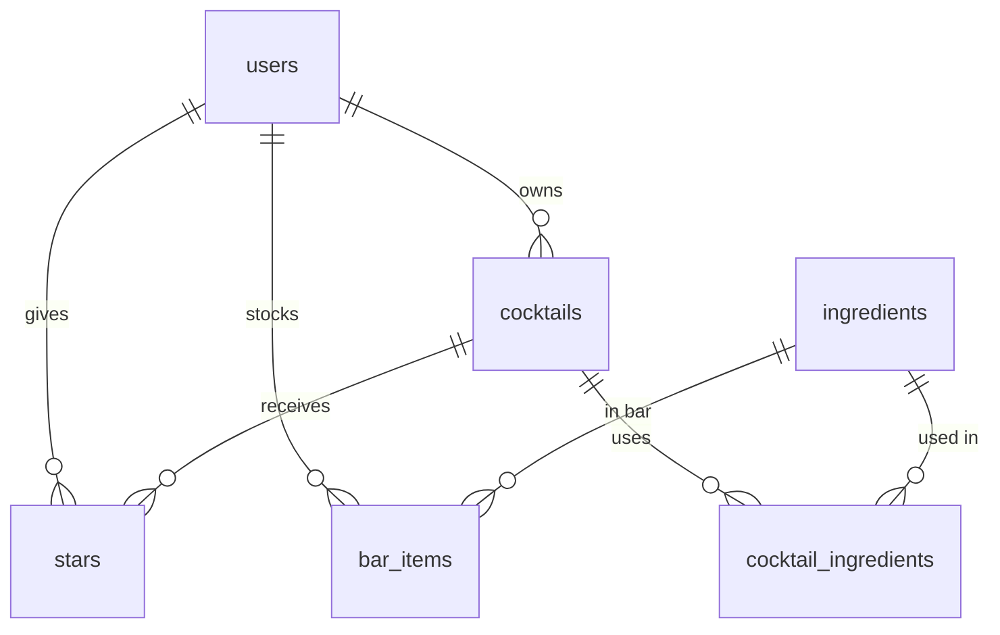

# Back Bar — PLAN.md

## 1. Pitch

I'm building **Back Bar**, a personal cocktail recipe box that also tells me **what I can make right now with the bottles I have**, because I keep recipes scattered across notes, screenshots, and bar menus, and I never remember which drinks my home bar can actually support.

I'll use it 2–3 times a week: logging a new recipe after a bar visit, and checking "what can I make tonight" before friends come over. Anyone can sign up and get their own private bar, titled with their name (e.g. "Ray's Bar").

## 2. Features (user stories, in build order)

**Spine**

1. **Sign up and login** — As a new visitor, I want to create an account with a display name, username, and password, then log in and log out, so that my recipes and bar are private to me. After login, the header reads "{display name}'s Bar".
2. **Data model** — As a user, I want my recipes to be built from a shared ingredient list (not free text), so that "lime juice" always means the same thing and matching works.
3. **Create / read / update / delete recipes** — As a user, I want to add a cocktail with a name, base spirit, glass, method steps, a 1–5 rating, notes, and one or more ingredient rows (ingredient + amount, e.g. "Gin — 1 oz"), view my list, open a recipe's detail page, edit it, and delete it after an "Are you sure?" confirmation, so that I keep one clean recipe box.
4. **Validation** — As a user, I want a friendly message if I leave name, base spirit, or method blank, or add zero ingredients, so that I never save a broken recipe.
5. **Stars** — As a user, I want to star any recipe and see a "Starred" view, so that I can find my go-to drinks fast.
6. **Find things** — As a user, I want to search by cocktail or ingredient name, filter by base spirit, and sort by newest, highest rated, or A–Z, so that I can find a drink in seconds.
7. **Dashboard** — As a user, I want to see total recipes, average rating, and how many recipes I can make right now, plus a bar chart of recipes by base spirit, so that I understand my taste and my bar at a glance.

**My 3 features**

8. **My Bar + "What can I make?"** — As a user, I want to tick the ingredients I have at home, and see every recipe whose ingredients are all in my bar, so that I know what I can make tonight.
9. **"One bottle away"** — As a user, I want to see recipes that are missing exactly one ingredient, and which ingredient it is, so that I know what to buy next.
10. **Random pick** — As a user, I want a "Surprise me" button that picks a random recipe I can make right now, so that I don't default to the same drink every time.

## 3. Database

| Table | Columns (type) | Keys |
|---|---|---|
| `users` | id (number), username (text, unique), display_name (text), password_hash (text), created_at (date) | PK id |
| `cocktails` | id (number), user_id (number), name (text), base_spirit (text: gin / whiskey / rum / tequila / vodka / brandy / other), glass (text), method (text), rating (number, 1–5), notes (text), created_at (date) | PK id; FK user_id → users |
| `ingredients` | id (number), name (text, unique), category (text: spirit / liqueur / juice / syrup / bitters / garnish / other) | PK id |
| `cocktail_ingredients` | id (number), cocktail_id (number), ingredient_id (number), amount (text, e.g. "1 oz") | PK id; FK → cocktails, ingredients; unique (cocktail_id, ingredient_id) |
| `bar_items` | user_id (number), ingredient_id (number), added_at (date) | PK (user_id, ingredient_id); FK → users, ingredients |
| `stars` | user_id (number), cocktail_id (number), created_at (date) | PK (user_id, cocktail_id); FK → users, cocktails |

**Relationships**
- users → cocktails: **one-to-many** (each recipe belongs to one user)
- cocktails ↔ ingredients: **many-to-many** via `cocktail_ingredients`
- users ↔ ingredients: **many-to-many** via `bar_items` (what's in my bar)
- users ↔ cocktails: **many-to-many** via `stars` (one table for all users)
- `ingredients` is a shared catalog seeded with ~50 common ingredients; any user can add a new one. Ingredient names are not private data; recipes, bar contents, and stars are.

## 4. Tests

1. **Data isolation** — *Given* User A has saved a "Negroni" recipe, *when* User B logs in and requests the recipe list and A's recipe detail page by its id, *then* B's list is empty and the detail request returns "not found" (404).
2. **Dashboard average rating** — *Given* a user with three recipes rated 3, 4, and 5, and another user with a recipe rated 1, *when* the first user loads the dashboard stats, *then* the average rating is 4.0 and the total is 3 (the other user's recipe is not counted).

## 5. Technologies

| Choice | What | Why |
|---|---|---|
| Coding agent | Replit Agent | I've used it all semester, and it handles database, hosting, and deploys in one place. |
| Frontend / backend | React + Express (TypeScript) | Replit Agent's default stack, so fewer surprises. |
| Database | Replit PostgreSQL with Drizzle ORM | Built into Replit; relational tables suit the many-to-many joins this app needs. |
| Sign up / login | Username + password, hashed with bcrypt, kept in a session cookie | Lets me do a live sign-up in the demo, and lets tests create users A and B in code. |
| Hosting | Replit Deployments | One-click redeploy after each merged PR keeps the live URL current. |
| Chart | Recharts | Simple React bar chart for the dashboard. |
| Tests | Vitest + Supertest | Can call the API as two different users and check the responses. |
| Version control | GitHub repo, feature branches, PRs into main | Required workflow; Replit's Git pane pushes branches. |

## 6. Design

- **Style:** minimal and tool-like, not "bar-themed" kitsch. White background, generous whitespace, thin hairline dividers, list rows rather than heavy cards.
- **Colors:** background #FFFFFF, text #1A1A1A, secondary text #8A8A85, borders #EDEDEA, one accent in muted sage green #5F7361 (light tint #E7EDE6) for stars, buttons, and "can make" badges.
- **Type:** Inter (sans-serif), two weights only (regular and medium).
- **Inspiration:** Things 3 (calm lists, one accent color) and Paprika (clean recipe detail pages).

## 7. Risks and cuts

- **Least sure I can build:** the recipe form with a dynamic list of ingredient rows (add / remove a row, pick from a searchable ingredient dropdown), and keeping the "What can I make?" matching correct when recipes are edited.
- **Process risk:** Replit Agent auto-commits checkpoints to whatever branch is checked out. I'll always switch to the feature branch *before* prompting, so nothing lands on main directly.
- **Cut first:** "One bottle away" (feature 9). If time runs out, I'll replace it with a dark mode toggle, which is smaller.
- **Simplify if needed:** amounts stay free text ("1 oz", "2 dashes") rather than number + unit.

---

## Plan vs. Reality

| Planned feature | Shipped / Changed / Cut | Status | Learning | What changed and why (one line) |
|---|---|---|---|---|
| 1. Sign up and login | Shipped | Done | The Replit preview pane couldn't keep a login session, so the agent never saw any signed-in page — I had to be the one who looked. | Worked as planned; deployment config needed its own unplanned PR before the app could go live. |
| 2. Data model | Changed | Done | A shared ingredient list needs a hierarchy: "Gin" and "London dry gin" are separate rows, so a substitute counts as missing. | Built as designed, but my plan's "any user can add a new ingredient" line was silently dropped until the stranger test exposed it. |
| 3. Create / read / update / delete | Shipped | Done | "It builds" is not "it works" — I caught the Delete button cut off at the page edge only by clicking through it myself. | Same PR included a layout-only bug fix prompt. |
| 4. Validation | Shipped | Done | Validating on the server too means the API can't save a broken recipe even if the form is bypassed. | As planned. |
| 5. Stars | Shipped | Done | One junction table (user_id, cocktail_id) for everyone is simpler than per-user lists. | As planned. |
| 6. Search, filter, sort | Shipped | Done | Searching by ingredient ("campari" → Negroni) turned out to be the most useful part. | As planned. |
| 7. Dashboard | Shipped | Done | Putting the stats in their own function made them testable. | Added a "starred recipes" stat that wasn't in the plan. |
| 8. My Bar + What can I make | Shipped | Done | The matching is only as good as the ingredient data behind it. | As planned. |
| 9. One bottle away | Shipped | Done | It was the first thing I planned to cut, but it was quick because it reused the My Bar matching logic. | Not cut. |
| 10. Random pick | Shipped | Done | Small features with a clear rule are cheap to build and test. | As planned. |
| Tests (data isolation, dashboard average) | Shipped | Done | The agent broke, ran, and restored the code on its own, so I had no failing screenshot; I re-prompted it to stop after the break. | Red/green done by hand on the second try. |
| Add a missing ingredient (PLAN.md §3, not a numbered feature) | Missed, then shipped | Done | Requirements buried in the schema section, not in the numbered feature list, got skipped. | Built after the stranger test showed "What can I make?" gave wrong answers without it. |
| Dark mode (backup cut option) | Cut | Backlogged | — | Not needed, since feature 9 wasn't cut. |
