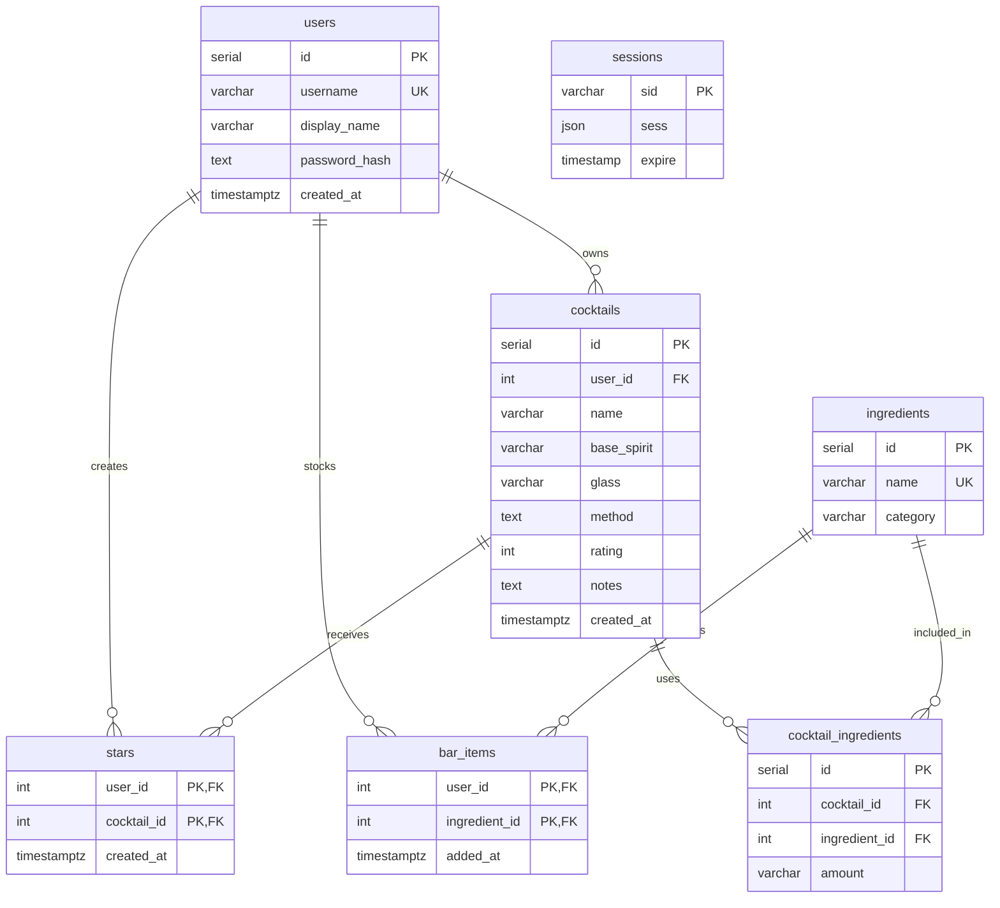

# Back Bar database schema

This reference is generated from the Drizzle declarations in [`db/schema.ts`](db/schema.ts). PostgreSQL types are shown below; `serial` is an auto-incrementing integer.

## Tables

### `users`

| Column | PostgreSQL type | Null/default | Constraints |
|---|---|---|---|
| `id` | `serial` | Not null | Primary key |
| `username` | `varchar(64)` | Not null | Unique |
| `display_name` | `varchar(80)` | Not null | |
| `password_hash` | `text` | Not null | |
| `created_at` | `timestamp with time zone` | Not null, `now()` | |

### `cocktails`

| Column | PostgreSQL type | Null/default | Constraints |
|---|---|---|---|
| `id` | `serial` | Not null | Primary key |
| `user_id` | `integer` | Not null | FK to `users.id`, `ON DELETE CASCADE` |
| `name` | `varchar(160)` | Not null | |
| `base_spirit` | `varchar(32)` | Not null | Check: `gin`, `whiskey`, `rum`, `tequila`, `vodka`, `brandy`, or `other` |
| `glass` | `varchar(100)` | Not null | |
| `method` | `text` | Not null | |
| `rating` | `integer` | Not null | Check: between 1 and 5 |
| `notes` | `text` | Not null, empty string | |
| `created_at` | `timestamp with time zone` | Not null, `now()` | |

Index: `cocktails_user_id_idx` on `user_id`.

### `ingredients`

| Column | PostgreSQL type | Null/default | Constraints |
|---|---|---|---|
| `id` | `serial` | Not null | Primary key |
| `name` | `varchar(120)` | Not null | Unique, case-sensitive database constraint |
| `category` | `varchar(24)` | Not null | |

The API accepts the categories `spirit`, `liqueur`, `juice`, `syrup`, `bitters`, `garnish`, and `other`. The database schema itself does not declare a category check constraint.

### `cocktail_ingredients`

| Column | PostgreSQL type | Null/default | Constraints |
|---|---|---|---|
| `id` | `serial` | Not null | Primary key |
| `cocktail_id` | `integer` | Not null | FK to `cocktails.id`, `ON DELETE CASCADE` |
| `ingredient_id` | `integer` | Not null | FK to `ingredients.id`; no cascade is declared |
| `amount` | `varchar(100)` | Not null | |

Unique constraint: `cocktail_ingredients_cocktail_ingredient_unique` on (`cocktail_id`, `ingredient_id`). Index: `cocktail_ingredients_ingredient_id_idx` on `ingredient_id`.

### `bar_items`

| Column | PostgreSQL type | Null/default | Constraints |
|---|---|---|---|
| `user_id` | `integer` | Not null | Part of primary key; FK to `users.id`, `ON DELETE CASCADE` |
| `ingredient_id` | `integer` | Not null | Part of primary key; FK to `ingredients.id`; no cascade is declared |
| `added_at` | `timestamp with time zone` | Not null, `now()` | |

Composite primary key: (`user_id`, `ingredient_id`). Index: `bar_items_ingredient_id_idx` on `ingredient_id`.

### `stars`

| Column | PostgreSQL type | Null/default | Constraints |
|---|---|---|---|
| `user_id` | `integer` | Not null | Part of primary key; FK to `users.id`, `ON DELETE CASCADE` |
| `cocktail_id` | `integer` | Not null | Part of primary key; FK to `cocktails.id`, `ON DELETE CASCADE` |
| `created_at` | `timestamp with time zone` | Not null, `now()` | |

Composite primary key: (`user_id`, `cocktail_id`).

### `sessions`

This table is used by `connect-pg-simple` to store Express sessions.

| Column | PostgreSQL type | Null/default | Constraints |
|---|---|---|---|
| `sid` | `varchar(255)` | Not null | Primary key |
| `sess` | `json` | Not null | |
| `expire` | `timestamp(6) without time zone` | Not null | |

Index: `sessions_expire_idx` on `expire`. No foreign keys are declared on this table.

## Relationships

- A user has many cocktails; each cocktail belongs to one user. Deleting a user cascades to their cocktails.
- Cocktails and ingredients are many-to-many through `cocktail_ingredients`. Deleting a cocktail cascades to its ingredient rows; deleting an ingredient referenced by a cocktail ingredient row is not configured to cascade.
- Users and ingredients are many-to-many through `bar_items`. Deleting a user cascades to their bar items; deleting an ingredient referenced by a bar item is not configured to cascade.
- Users and cocktails are many-to-many through `stars`. Deleting either the user or cocktail cascades to associated stars.
- Sessions are stored separately and have no declared relation to `users`.

## Entity relationship diagram

## Compared with PLAN.md section 3

- The six planned tables (`users`, `cocktails`, `ingredients`, `cocktail_ingredients`, `bar_items`, and `stars`) are all present.
- The actual schema adds a `sessions` table (`sid`, `sess`, `expire`) and an `sessions_expire_idx` index for PostgreSQL-backed login sessions.
- No planned columns are missing or renamed. The database uses concrete sizes and types, including bounded `varchar` columns and timezone-aware timestamps; `sessions.expire` is a timestamp without a time zone.
- The actual schema adds a base-spirit check constraint, a 1–5 rating check, and indexes on cocktail ownership and ingredient references.
- The planned keys and junction-table unique/composite keys are present. The actual schema also cascades user deletion to cocktails and bar items, cocktail deletion to cocktail ingredients, and user or cocktail deletion to stars. No cascade is declared for ingredient references.
- The database enforces ingredient-name uniqueness with a case-sensitive unique constraint. The API separately trims and matches new ingredient names case-insensitively.
- The plan lists ingredient categories, but the database does not enforce them with a check constraint; the API validates the supported category values.
